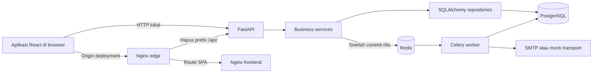
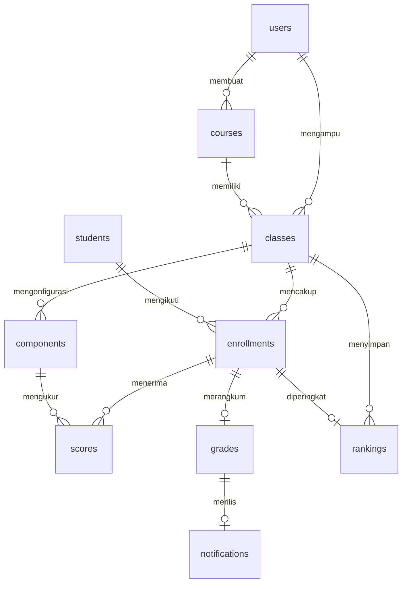

# Arsitektur

## Komponen runtime



Profile Compose lokal menjalankan Vite, Uvicorn dengan reload, worker, PostgreSQL, dan Redis. Staging/production membangun aset frontend statis, menjalankan layanan migration satu kali, lalu memulai layanan API/worker setelah migration berhasil. Reverse proxy eksternal melakukan terminasi TLS; Nginx edge dalam repository melayani HTTP dan dipublikasikan pada loopback.

## Lapisan backend

| Lapisan | Tanggung jawab | Source |
| --- | --- | --- |
| Application | Registrasi router, CORS, rate limiting, seed saat startup | [`main.py`](../backend/app/main.py) |
| Dependencies | Verifikasi JWT, muat ulang akun aktif, terapkan role | [`dependencies.py`](../backend/app/dependencies.py) |
| Routers | Status HTTP, request binding, serialisasi response | [`routers/`](../backend/app/routers/) |
| Schemas | Batasan field dan bentuk request/response publik | [`schemas/`](../backend/app/schemas/) |
| Services | Otorisasi resource, perhitungan, koordinasi transaksi | [`services/`](../backend/app/services/) |
| Repositories | Query SQLAlchemy dan operasi persistence | [`repositories/`](../backend/app/repositories/) |
| Models | Tabel, foreign key, constraint database | [`models/`](../backend/app/models/) |

Setiap request memperoleh async session. `get_db` menutup session tanpa melakukan commit otomatis. Sebagian repository CRUD melakukan commit sendiri; service penilaian dan finalisasi mengoordinasikan commit beberapa tabel. Periksa repository terkait sebelum menggabungkan operasi ke dalam satu transaksi.

## Relasi data



Profil mahasiswa terpisah dari akun login. Enrollment mengidentifikasi mahasiswa dalam satu kelas: penyimpanan skor dan laporan individual memakai UUID enrollment, sedangkan riwayat memakai UUID mahasiswa. Grade menyimpan status draft/final dan field audit rilis. Ranking disimpan saat rilis. Record notification unik per grade serta menyimpan generasi dispatch, status, error, dan timestamp pengiriman.

Alembic mengelola perubahan schema. Komentar tabel dan kolom berbahasa Indonesia serta dapat diperiksa terhadap PostgreSQL melalui `backend/scripts/verify_comments.py`.

## Input dan perhitungan nilai

Konfigurasi wajib memiliki bobot positif dengan total tepat 100%, nilai maksimum positif pada setiap komponen, serta minimal satu `uts` dan satu `uas`. Kategori yang didukung adalah `tugas`, `uts`, `uas`, dan `custom`.

```text
final_score = sum(score / max_score * weight)
```

[`services/grade.py`](../backend/app/services/grade.py) memakai pecahan eksak dari input Decimal, kemudian melakukan pembulatan half-up ke dua angka desimal. Skor yang belum diisi menyumbang nol pada draft tanpa mendistribusikan ulang bobot. Input yang belum lengkap tetap menghalangi finalisasi; nilai nol yang tersimpan dianggap lengkap.

Request PUT skor berupa map parsial: nilai numerik melakukan insert/update, `null` menghapus skor draft, dan ID komponen yang tidak dikirim tetap dipertahankan. Row lock pada kelas mengoordinasikan penyimpanan skor, perubahan komponen, perubahan roster, dan rilis. Komponen yang sudah memiliki skor tidak dapat dihapus, dan nilai maksimumnya tidak dapat diturunkan di bawah skor tersimpan. Perubahan komponen yang valid menghitung ulang total draft.

## Rilis final dan pengiriman

1. Kunci kelas, verifikasi akses, dan tolak grade yang sudah difinalisasi.
2. Validasi konfigurasi lengkap, roster yang tidak kosong, rentang skor, dan setiap skor wajib.
3. Hitung total dan tandai grade sebagai `finalized` dengan timestamp bersama serta pengguna yang merilis.
4. Simpan ranking memakai `row_number`: skor menurun, NIM menaik, kemudian nama menaik. Skor seri memperoleh posisi berbeda.
5. Buat record notification dan commit transaksi database.
6. Publikasikan job Celery melalui Redis dan catat kegagalan enqueue secara terpisah.
7. Worker memeriksa status rilis/dispatch, mengirim melalui SMTP atau mock transport, lalu menyimpan hasil pengiriman.

HTTP 202 mengembalikan `finalized_count` dan `notified`; field terakhir menghitung job yang diterima queue, bukan email yang sudah terkirim. Kegagalan queue tidak melakukan rollback rilis. Retry admin memberikan dispatch token baru; worker mengabaikan percobaan bertoken yang tidak lagi cocok dengan record. Task mengizinkan tiga retry dengan jeda eksponensial. Record berstatus sent menolak retry admin.

Database dan broker tidak berbagi transaksi atomik. SMTP dan pencatatan keberhasilannya di database juga merupakan operasi terpisah; implementasi tidak menjamin pengiriman exactly-once.

## Autentikasi dan akses

Password memakai bcrypt. JWT access dan refresh memiliki tipe, waktu kedaluwarsa, serta identifier berbeda; nilai default adalah 15 menit dan tujuh hari. Setiap request terautentikasi memuat ulang pengguna dari PostgreSQL dan menolak akun nonaktif. Superadmin mengakses semua kelas; dosen mengakses kelas yang diampu. Daftar dan pembacaan mata kuliah mencakup mata kuliah yang dibuat atau diampu dosen melalui penugasan kelas; update/delete mata kuliah memerlukan hak pembuat/admin. Kedua role dapat membaca direktori mahasiswa; update/delete hanya tersedia bagi admin. Riwayat memfilter hasil rilis berdasarkan kelas dosen yang meminta.

Identifier refresh yang sudah dipakai disimpan dalam set lokal proses, hilang saat restart, dan tidak dibagikan antar-worker Uvicorn. Axios memakai satu request refresh bersama untuk response 401 yang terjadi bersamaan, lalu mengulang setiap request asal satu kali. Zustand menyimpan token di browser storage, tetapi memuat ulang profil pengguna. Bootstrap seed tidak mengubah password yang sudah ada, dan startup menekan exception seed.

## State frontend

[`App.tsx`](../frontend/src/App.tsx) merangkai React Router dan TanStack Query. Axios bersama menangani autentikasi; query key akademik mencakup identitas pengguna. Zustand mengelola state sesi. Engine draft nilai mengelola input tertunda, penyimpanan, error, dan rekonsiliasi dengan snapshot server. Penempatan engine pada tingkat halaman kelas mempertahankan edit saat berpindah tab. Navigation guard menangani pekerjaan tertunda; finalisasi menyelesaikan penyimpanan dan memuat ulang snapshot.

Analitik kelas/mahasiswa memakai Recharts dan data API. Sejumlah halaman dan chart dimuat secara lazy. `/users` dan `/notifications` hanya dapat diakses superadmin. Dialog akun membuat/memperbarui pengguna, mengubah password secara opsional, dan menonaktifkan akun melalui API administratif yang sudah ada. Wrapper TanStack Table bersama menyediakan sorting dan pagination di client untuk pengguna, notifikasi, mata kuliah, kelas per mata kuliah, mahasiswa, dan roster kelas. Ukuran halaman default adalah 10, dengan pilihan 10/25/50; server tetap mengembalikan array, bukan response dengan pagination.

Filter role/status pengguna dan status notifikasi diterapkan saat form dikirim dan disertakan dalam query key. Pencarian berjalan lokal pada record hasil filter server. Kartu ringkasan akun mencerminkan daftar hasil filter server. Detail mata kuliah memfilter record kelas yang terlihat berdasarkan ID mata kuliah. Breadcrumb mempertahankan konteks mata kuliah pada halaman kelas, dan item navigasi mata kuliah tetap aktif di sana. Akses notifikasi admin berada pada ikon lonceng di header; identitas sesi dan logout berada di bagian bawah sidebar.

## Dataset seed persisten

[`app/seeding/`](../backend/app/seeding/) memuat CLI opsional yang terpisah dari bootstrap superadmin saat startup. Polyfactory/Faker (`id_ID`), RNG lokal berbasis seed, dan identifier UUIDv5 membentuk graph akademik serta sample request positif/negatif yang dapat direproduksi. Generator versi 3 berada dalam batas 5–15 mata kuliah, 2–5 kelas per mata kuliah, dan 5–15 mahasiswa terdaftar per kelas; kapasitas untuk mencakup seluruh case membatasi total yang dipilih secara acak.

`plan` membangun graph dan menulis manifest tanpa terhubung ke PostgreSQL. `apply` mengambil advisory lock dataset, melakukan insert sesuai urutan foreign key dalam satu transaksi, dan memperlakukan anchor yang sudah ada sebagai read-only. Fingerprint manifest mencegah penggunaan ulang nama dataset untuk konfigurasi berbeda. Graph mencakup grade draft/final, ranking, dan record notification simulasi tanpa memublikasikan task Celery atau mengirim email. `inspect` memeriksa ID record yang diharapkan dan melaporkan row yang hilang; perintah ini tidak memulihkan row terhapus atau membandingkan setiap field yang diubah saat pengujian manual. Inspeksi CLI juga memperbarui artefak manifest lokal.

Data seed manual tetap tersimpan untuk pengujian human. Pytest memakai target layanan disposable yang dipilih eksplisit dan ditegakkan sebelum import aplikasi oleh [`tests/support/database_guard.py`](../backend/tests/support/database_guard.py). Lihat [seeding](seeding.md) untuk operasi dan [pengujian](testing.md) untuk isolasi.

## Laporan dan batas deployment

Service memeriksa otorisasi akses kelas dan mewajibkan hasil final sebelum rendering. Export kelas mewajibkan seluruh grade pada roster sudah final. Template Jinja2 memakai autoescape; rendering PDF menolak pengambilan resource eksternal. WeasyPrint memerlukan library native yang disediakan image backend. XLSX menulis teks dari mahasiswa sebagai cell string. Rendering memakai `asyncio.to_thread`, dan download mengatur `Cache-Control: no-store`.

Nginx deployment menghapus prefix `/api/` sebelum meneruskan request ke FastAPI. OpenAPI dapat diakses pada `/api/openapi.json`. Tanpa `root_path` aplikasi, Swagger deployment meminta `/openapi.json`, bukan schema dengan prefix; lihat [deployment](deployment.md#reverse-proxy-dan-tls).

`GET /health` mengembalikan HTTP 200 dan `status: ok` meskipun dependensi tidak tersedia. Pemanggil harus memeriksa `db` dan `redis`; probe API deployment memeriksa keduanya. Lihat [keputusan teknis](decisions.md) untuk trade-off.
