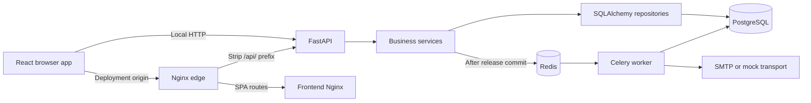
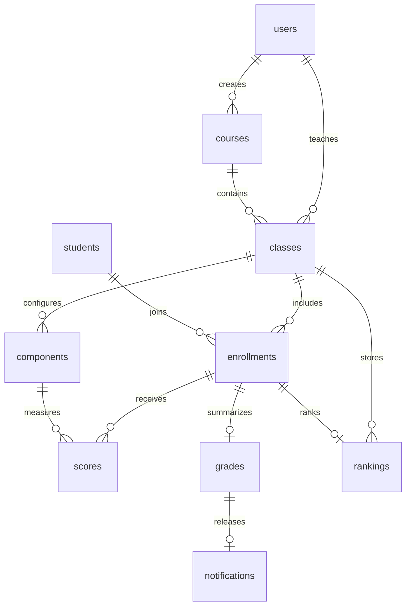

# Architecture

## Runtime components



The local Compose profile runs Vite, Uvicorn with reload, a worker, PostgreSQL, and Redis. Staging/production build static frontend assets, run a one-shot migration service, and start API/worker services after migration succeeds. An external reverse proxy terminates TLS; the repository's edge Nginx listens on HTTP and is published on loopback.

## Backend layers

| Layer | Responsibility | Source |
| --- | --- | --- |
| Application | Router registration, CORS, rate limiting, startup seed | [`main.py`](../backend/app/main.py) |
| Dependencies | Verify JWT, reload active account, enforce role | [`dependencies.py`](../backend/app/dependencies.py) |
| Routers | HTTP status, request binding, response serialization | [`routers/`](../backend/app/routers/) |
| Schemas | Field constraints and public request/response shapes | [`schemas/`](../backend/app/schemas/) |
| Services | Resource authorization, calculations, transaction coordination | [`services/`](../backend/app/services/) |
| Repositories | SQLAlchemy queries and persistence operations | [`repositories/`](../backend/app/repositories/) |
| Models | Tables, foreign keys, database constraints | [`models/`](../backend/app/models/) |

An async session is provided per request. `get_db` closes the session without automatically committing it. Some CRUD repositories commit themselves; grading and finalization services coordinate multi-table commits. Check the specific repository before composing operations into a transaction.

## Data relationships



Student profiles are separate from login accounts. Enrollments identify a student in one class: score writes and individual reports use the enrollment UUID, while history uses the student UUID. Grades retain draft/final status and release audit fields. Rankings are persisted on release. Notification records are unique per grade and retain dispatch generation, status, error, and delivery timestamps.

Alembic manages schema changes. Table and column comments are in Indonesian and can be checked against PostgreSQL with `backend/scripts/verify_comments.py`.

## Grade entry and calculation

The configuration must have positive weights totaling exactly 100%, a positive maximum per component, and at least one `uts` and one `uas`. Supported categories are `tugas`, `uts`, `uas`, and `custom`.

```text
final_score = sum(score / max_score * weight)
```

[`services/grade.py`](../backend/app/services/grade.py) uses exact fractions from decimal inputs, then rounds half-up to two decimal places. Missing scores contribute zero to a draft without redistributing weights. Missing entries still block finalization; a stored zero is complete.

Score PUT requests are partial maps: numeric values insert/update, `null` deletes a draft score, and omitted component IDs remain unchanged. A class row lock coordinates score saves, component edits, roster changes, and release. Components with scores cannot be removed, and their maximum cannot be reduced below existing scores. Valid component changes recalculate draft totals.

## Final release and delivery

1. Lock the class, verify access, and reject previously finalized grades.
2. Validate the complete configuration, nonempty roster, score ranges, and every required score.
3. Calculate totals and mark grades `finalized` with a common timestamp and releasing user.
4. Insert rankings with `row_number`: score descending, NIM ascending, then name ascending. Tied scores receive distinct positions.
5. Create notification records and commit the database transaction.
6. Publish Celery jobs through Redis and record enqueue failures separately.
7. The worker checks release/dispatch state, sends via SMTP or mock transport, and persists delivery outcome.

HTTP 202 returns `finalized_count` and `notified`; the latter counts accepted queue submissions, not delivered emails. Queue failure does not roll back the release. Admin retry assigns a new dispatch token; the worker ignores a token-bearing attempt whose token no longer matches the record. The task permits three retries with exponential delays. Sent records reject admin retry.

The database and broker do not share an atomic transaction. SMTP and its database acknowledgement are also separate operations; the implementation does not provide an exactly-once delivery guarantee.

## Authentication and access

Passwords use bcrypt. Access and refresh JWTs have separate types, expiry, and identifiers; defaults are 15 minutes and seven days. Each authenticated request reloads the user from PostgreSQL and rejects inactive accounts. Superadmins access all classes; lecturers access their assigned classes. Course lists and reads include courses a lecturer created or teaches through an assigned class; course update/delete requires creator/admin permissions. Student directory reads are available to both roles; update/delete is admin-only. History filters released results by the requesting lecturer's classes.

Used refresh identifiers are held in a process-local set, lost on restart and not shared across Uvicorn workers. Axios shares one refresh request across simultaneous 401 responses and retries each original request once. Zustand persists tokens in browser storage but reloads the user profile. The bootstrap seed does not change existing passwords, and startup suppresses seed exceptions.

## Frontend state

[`App.tsx`](../frontend/src/App.tsx) composes React Router and TanStack Query. Shared Axios handles authentication; academic query keys include user identity. Zustand owns session state. The grade draft engine owns pending input, saves, errors, and reconciliation with server snapshots. Keeping the engine at class-page level preserves edits across tabs. Navigation guards handle pending work; finalization flushes saves and reloads the snapshot.

Class/student analytics use Recharts and API data. Several pages and charts are lazy-loaded. `/notifications` is admin-only; `/users` currently renders a placeholder despite the implemented account API.

## Reports and deployment boundaries

Services authorize class access and require finalized results before rendering. Class exports require every roster grade to be final. Jinja2 templates autoescape; PDF rendering rejects external resource fetching. WeasyPrint requires native libraries supplied by the backend image. XLSX writes student-controlled text as string cells. Rendering uses `asyncio.to_thread`, and downloads set `Cache-Control: no-store`.

Deployment Nginx strips `/api/` before FastAPI. OpenAPI is reachable at `/api/openapi.json`. Without an application `root_path`, deployed Swagger requests `/openapi.json` instead of the prefixed schema; see [deployment](deployment.md#reverse-proxy-dan-tls).

`GET /health` returns HTTP 200 and `status: ok` even if dependencies are unavailable. Consumers must inspect `db` and `redis`; the deployment API probe does so. See [technical decisions](decisions.md) for trade-offs.
